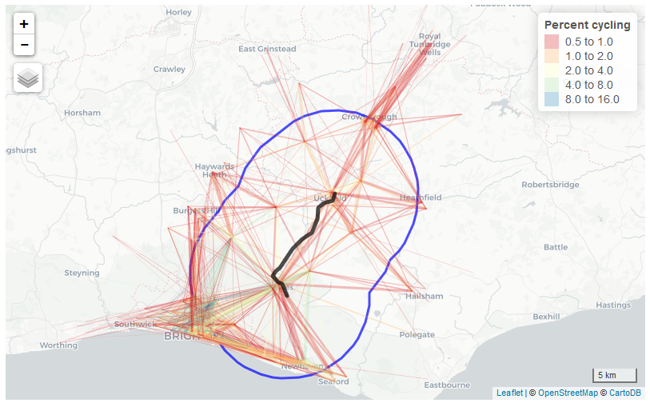
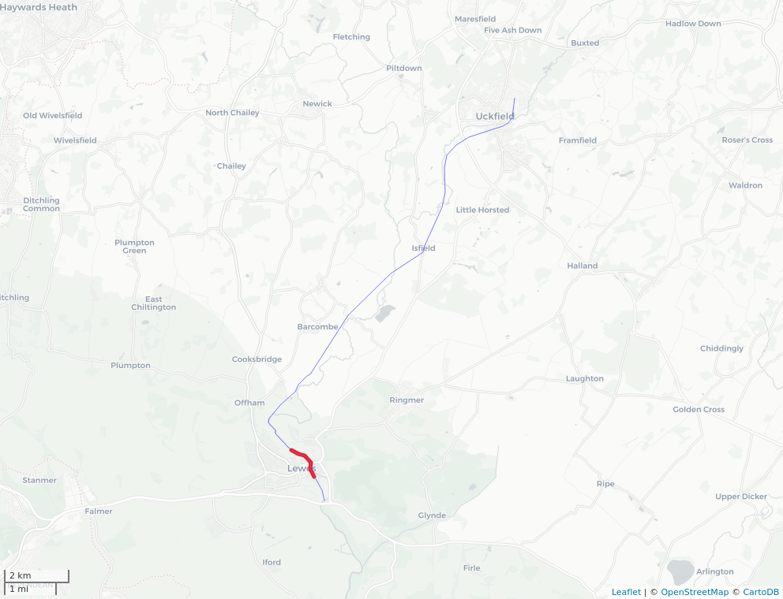
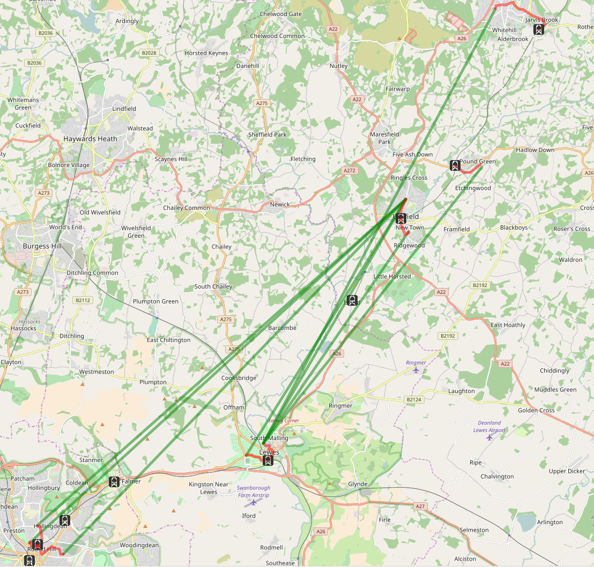

## Abstract

Major transport infrastructure projects shape travel behaviour, health and local accessibility for decades. Economic appraisal, cost-benefit analysis and Environmental Impact Assessment are well established, and Health Impact Assessment (HIA) has grown in prominence. Yet *a priori* geographic methods for assessing how major linear schemes affect walking and cycling remain scarce, and empirical evidence on the severance imposed by existing national road networks is limited. This paper sets out Active Travel Impact Assessment (ATIA) methods built around three spatial relations between linear infrastructure and active travel desire lines: *severance*, where a corridor cuts across routes with walking and cycling potential; *parallels*, where new paths alongside a corridor can capture trips; and *integration*, where public transport stops unlock multi-stage active journeys. We illustrate these corridor methods on a proposed railway between Lewes and Uckfield in East Sussex, then apply the severance lens to England's Strategic Road Network (SRN) using Census 2021 data to quantify how proximity to motorways and major trunk roads suppresses local walking and cycling.

## Introduction

Major transport infrastructure receives substantial public investment worldwide, justified by economic growth [@preston_economics_2013], reduced regional disparities [@liu_spatial_2016], modal shift to rail [@dobruszkes_highspeed_2011], and travel time savings [@fischerjamiemontague_quality_2011]. In practice, political and psychological biases frequently overstate benefits and underestimate costs [@flyvbjerg_policy_2005; @cantarelli_characteristics_2012]. Calls for evidence-based appraisal [@hodge_publicprivate_2010] emphasise environmental [@akerman_role_2011], health [@mueller_health_2015] and social [@jones_social_2012] externalities.

Impact assessment offers established frameworks for these effects across Environmental Impact Assessment (EIA), Strategic Environmental Assessment (SEA), Health Impact Assessment (HIA) and Equality Impact Assessment (EqIA) [@tajima_should_2013], with HIA spanning mandated, decision-support, advocacy and community-led practice [@harris-roxas_differing_2011]. Walking and cycling cut across all of these domains, delivering physical activity gains [@gotschi_contrasts_2015; @mueller_health_2015], lower energy use [@lovelace_assessing_2011], cleaner urban air [@xia_trafficrelated_2015], and greater mobility for people without car access [@mullen_knowing_2014].

Despite these benefits, active travel is rarely quantified in infrastructure appraisal. Reviews note little empirical health data for road schemes beyond casualty counts [@thomson_assessing_2008]; classic HIA frameworks omit walking and cycling [@joffe_framework_2002] or confine them to road safety sub-topics [@cohen_health_2014]. *A posteriori* natural experiments such as the M74 evaluation in Glasgow show how hard behavioural effects are to isolate [@ogilvie_evaluating_2006], while reporting lower physical activity [@prins_effects_2017] and higher car use [@foley_effects_2017] near motorways, consistent with wider evidence on community severance [@mindell_community_2012; @anciaes_community_2016].

Organisational silos reinforce this gap: local authorities plan walking and cycling, whereas national agencies deliver motorways, trunk roads and railways. We frame Active Travel Impact Assessment (ATIA) as an open-source component of HIA, extending the desire-line methods of the Propensity to Cycle Tool (PCT) [@lovelace_propensity_2017] to corridor appraisal and to national severance along England's Strategic Road Network.

## The three geographic relations: severance, parallels and integration

Linear infrastructure alters active travel through its geometry relative to local trips. Post-construction impacts fall into three categories.

### Severance

Linear corridors create physical and perceptual barriers perpendicular to their alignment, severing existing and latent walking and cycling routes. Motorways, dual carriageways and railways are especially obstructive because they are fenced, fast-moving or grade-separated, restricting crossings to dedicated bridges, underpasses or signalised junctions. Mapping where high-potential desire lines cross a corridor helps planners locate crossings where they best preserve local connectivity.

### Parallels

New linear infrastructure also enables new footways and cycleways alongside the corridor. Where land acquisition and earthworks are already funded for a road or railway, adding a segregated parallel path typically has a lower marginal cost than building a standalone route. Parallel paths can convert motorised trips directly to active modes and feed trips to stations or crossings, prompting HIA to measure newly generated active travel alongside displaced trips.

### Integration

Where infrastructure delivers public transport services, stations and interchanges can stimulate active travel across surrounding catchments as part of multi-stage journeys [@flamm_public_2014]. Commuters who previously drove door to door may walk or cycle to a station, take the train, and walk at the destination end, lifting active travel at a distance from the line itself.

Construction-phase disruption, including road closures, detours and heavy goods traffic, can also suppress active travel over multi-year builds, though the methods below address permanent post-build relationships.

## Methods

The corridor-level ATIA methods use two inputs: the infrastructure alignment (centreline and stops) and origin-destination (OD) desire lines. Desire lines are straight lines between zone population-weighted centroids carrying commuter counts and modelled cycling potential from the PCT [@lovelace_propensity_2017]. The spatial operations are implemented in the open-source R package **stplanr** [@lovelace_stplanr_2018].

1. **Route segmentation and bearing.** Because long or curved corridors change direction and local context, `line_segment()` splits the alignment into equal segments (for example, 1 km), and `line_bearing()` computes the bearing of each segment and desire line.
2. **Angular comparison (`angle_diff`).** The function `angle_diff()` calculates the bidirectional angular difference (0 to 90 degrees) between desire lines and the corridor. Desire lines within 30 degrees of parallel that fall within proximity buffers represent **parallel** potential; aggregating their cycling potential by segment identifies where a parallel path serves most trips.
3. **Severance pinch points.** Desire lines roughly perpendicular to the corridor (angular difference above 60 degrees) that intersect it represent **severance**. Summing severed cycling potential per segment locates severance pinch points ("severance points") to prioritise bridges, tunnels or safe surface crossings.
4. **Public transport integration.** For **integration**, desire lines are filtered to origins and destinations within a station catchment (such as 3 km), excluding same-stop and already rail-connected pairs. Access legs are routed to the nearest stop, dropping pairs where combined active access exceeds 1.1 times direct cycling distance. Because fares, frequencies and car times are excluded, this flags priority station-access corridors rather than exact mode shift.

## Case study: the Lewes-Uckfield railway

We illustrate these methods on a proposed 16 km railway restoration between Lewes and Uckfield in East Sussex, using 2011 Census Middle layer Super Output Area (MSOA) commuter desire lines from the PCT [@lovelace_propensity_2017]. Within a 10 km buffer, 56,536 single-stage commuters travel on intersecting desire lines, mostly oriented towards Brighton to the south-west rather than along the track (@fig-lewes-overview).

{#fig-lewes-overview}

Applying `angle_diff()` with a 5 km midpoint buffer and 2 km corridor filter isolates parallel flows between Lewes, Ringmer and Uckfield, while intersecting lines angled above 60 degrees capture severance. Splitting the route into 1 km segments shows modest severance overall because the rural alignment avoids splitting major towns, peaking in a populated 1 km segment of Lewes (@fig-lewes-perpmost). Across PCT scenarios, parallel potential (roughly 1,500 to 2,500 commuters depending on buffer definition, with modelled cycle shares rising from around 1% at baseline to 6% under Go Dutch and over 12% under Ebikes) exceeds severed potential if a high-quality parallel path is provided.

{#fig-lewes-perpmost}

For integration, filtering origin-destination pairs within 3 km of proposed stations and excluding corridors already connected by rail yields 8 inter-station desire lines representing 574 commuters. Routing access legs from zone centroids to the nearest station highlights uneven local demand concentrated around specific stations rather than distributed uniformly along the line (@fig-lewes-stations).

{#fig-lewes-stations}

## Suppression of active travel near the Strategic Road Network

While the Lewes-Uckfield case illustrates *a priori* appraisal for a single proposed scheme, the largest severance effects in England arise from infrastructure already on the ground. England's Strategic Road Network (SRN) comprises 14,593 km of motorways and major trunk A-roads managed by National Highways [@nationalhighways_network_public]. Designed primarily for high-speed, long-distance motor traffic, these corridors are typically wide, grade-separated, fenced or flanked by slip roads and large roundabouts. For surrounding neighbourhoods, the SRN represents England's most imposing network of physical and perceptual barriers to everyday walking and cycling. A central empirical question follows directly from the severance framework: do communities living close to the SRN walk and cycle to work less than comparable communities further away?

To test this at national scale, we combine three open datasets across 33,755 Lower layer Super Output Areas (LSOAs) in England. First, commuter mode shares are taken from Census 2021 table TS061 (*Method used to travel to work*) [@ons_ts061_2022], giving the combined share of commuters walking or cycling in each LSOA across 18,083,865 commuters in total. Second, proximity to the SRN is measured as the straight-line distance from each LSOA population-weighted centroid to the nearest link in the National Highways Network Model (Public) dataset [@nationalhighways_network_public], grouped into distance bands. Third, because areas near motorways and trunk roads differ systematically in density, socioeconomic composition and settlement structure, we fit an ordinary least squares (OLS) regression of LSOA active commuting share on SRN distance band while controlling for population density, the Index of Multiple Deprivation (IMD) 2019 rank [@mhclg_imd_2019], and rural-urban classification.

Across England as a whole, the weighted active commuting share is 14.22%. Comparing communities close to the SRN with those further away reveals no meaningful deficit in walking and cycling. In unadjusted terms, LSOAs nearest the SRN exhibit an active commuting share only 0.21 percentage points lower than more distant areas. After controlling for population density, deprivation and rural-urban classification, the adjusted gap shrinks to 0.08 percentage points, with a 95% confidence interval of -0.30 to +0.45 points that rules out any suppression larger than half a percentage point. The scale of exposure makes the null estimate informative rather than reassuring by default: 1,042,378 commuters live in LSOAs within 500 m of the SRN, and at this resolution we find no detectable suppression of active commuting near the network. The most plausible reading is that centroid-to-road distance is too blunt an exposure measure to capture severance, which operates on specific desire lines and crossing points rather than uniform buffers, and that SRN corridors already sit within urban areas whose walking and cycling rates are set by other factors. The finding therefore bounds the average effect of SRN proximity, and sharpens rather than settles the question of where severance bites: route-level, origin-destination analysis can identify the specific crossings and corridors where suppression operates. Readers should consult the [SRN severance](srn.qmd) page of this site for the full LSOA-level regression tables, sensitivity checks and interactive national map.

## Discussion

This paper sets out Active Travel Impact Assessment (ATIA), demonstrates corridor-level methods for severance, parallels and integration, and examines severance along England's Strategic Road Network. Relative to the multi-billion-pound costs of major road and rail schemes, geographic ATIA demands modest analytical resources. Its greatest value is at scheme inception and scoping, when alignments, junction designs and whether to build remain open. The same desire-line methods also apply to repurposing disused railways or upgrading existing trunk corridors.

The SRN analysis shows the value of pairing corridor methods with national screening: the LSOA-level null result bounds the average effect of proximity, while the severance lens explains why a null screening result is consistent with severe local barriers at specific junctions and crossings. Addressing localised severance requires closer coordination between National Highways, local transport authorities and active travel bodies. Rather than treating walking and cycling as an afterthought during maintenance or junction upgrades, Road Investment Strategies and corridor studies should map severed desire lines systematically to target investment. Practical measures include direct grade-separated crossings, accessible foot and cycle bridges, well-lit underpasses and green bridges that reconnect communities and habitats to modern standards [@dft_ltn120_2020; @anciaes_community_2016], alongside segregated parallel routes where commuter demand aligns with trunk roads.

Future work should extend corridor models beyond commuting to school, shopping and leisure trips, automate per-segment angle calculations, and compare multiple alignment options. Equally important is how results are used: quantitative models must support rather than replace public consultation. Absolute impact figures risk false precision unless paired with sensitivity analysis and local scrutiny. Keeping data, code and interactive maps open source, as in the PCT [@lovelace_propensity_2017], enables planners and communities to examine trade-offs transparently.

## Acknowledgements

Thanks to Shane Snow (Department for Transport) for commissioning the Lewes-Uckfield analysis and providing maps of the proposed alignment, and to Matthew Whittle for digitising the route.

## References
