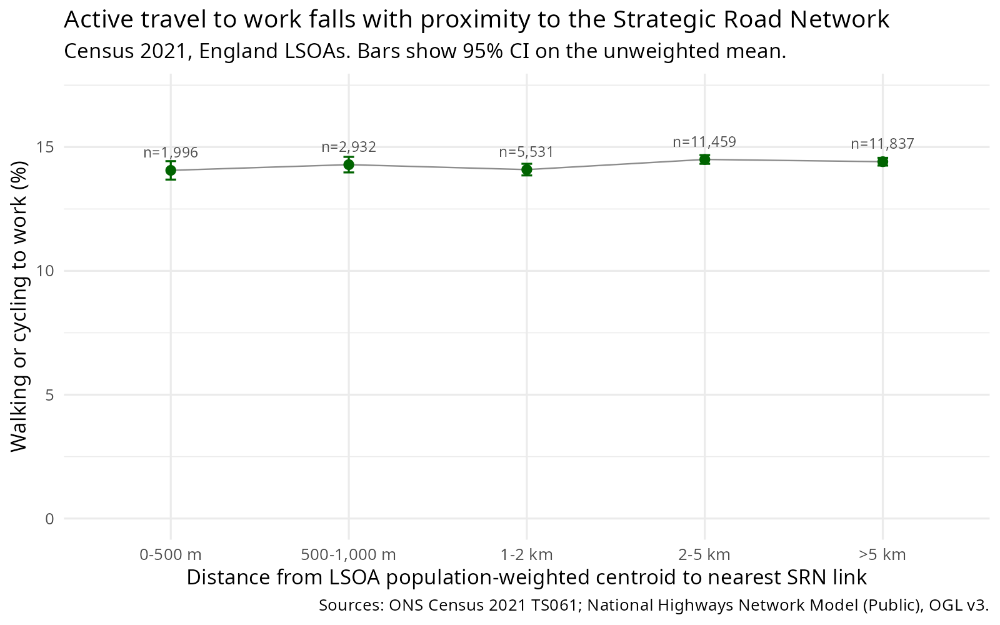

```{r}
#| include: false
library(data.table)
derived <- "data/derived"
band_summary <- fread(file.path(derived, "band_summary.csv"))
model_ols <- fread(file.path(derived, "model_ols.csv"))
model_wls <- fread(file.path(derived, "model_wls.csv"))
headline <- jsonlite::fromJSON(file.path(derived, "headline.json"))
fmt <- function(x) formatC(x, format = "f", digits = 1)
```

England's Strategic Road Network (SRN) is the country's most imposing web of
motorised barriers: some `r headline$srn_km` km of motorways and trunk roads
managed by National Highways, concentrated where demand for movement is
highest. This page quantifies one side effect of that network: whether people
who live close to it walk and cycle less.

## Data

All inputs are open (Open Government Licence):

- **Outcome**: Census 2021 ([TS061][]) method of travel to work at LSOA level;
  the active travel share is the percentage of commuting residents (excluding
  the mainly work-from-home group) who mainly walk or cycle to work.
- **Exposure**: distance from each LSOA population-weighted centroid to the
  nearest SRN link, from the [National Highways Network Model (Public)][nhnm]
  dataset (43,121 centre-line links, 14,593 km). Centroids are reconstructed
  from ONS Output Area (2021) population-weighted centroids, weighted by
  Census 2021 usual residents, following ONS centroid guidance.
- **Controls**: population density (Census 2021 usual residents per km2 of
  LSOA land), the [IMD 2019][imd] rank, and the ONS rural-urban
  classification (2021).

[TS061]: https://www.ons.gov.uk/datasets/TS061 "Census 2021 TS061"
[nhnm]: https://opendata.nationalhighways.co.uk "National Highways open data"
[imd]: https://www.gov.uk/government/statistics/english-indices-of-deprivation-2019 "IMD 2019"

The `r headline$n_lsoas` England LSOAs (2021 geography) fall into distance
bands from their centroid to the nearest SRN link. The `>5 km` band is the
reference group throughout.

## Descriptive statistics

```{r}
#| echo: false
band_labels <- c("0-500 m", "500-1,000 m", "1-2 km", "2-5 km", ">5 km")
bs <- copy(band_summary)
bs[, band := factor(band, levels = band_labels)]
setorder(bs, band)
knitr::kable(
  bs[, .(
    Band = band,
    LSOAs = formatC(n_lsoas, format = "d", big.mark = ","),
    Commuters = formatC(commuters, format = "d", big.mark = ","),
    `Mean active share (%)` = fmt(mean_share),
    `Commuter-weighted (%)` = fmt(weighted_share),
    `95% CI` = paste0(fmt(mean_share - 1.96 * se_share), "-", fmt(mean_share + 1.96 * se_share)),
    `Mean density (people/km2)` = formatC(mean_dens_km2, format = "d", big.mark = ",")
  )],
  align = "lrrrrrrr"
)
```

```{r}
#| echo: false
#| fig.alt: "Mean walking and cycling share of commuters by distance band to the nearest SRN link"

```

Descriptively, the commuter-weighted active travel share falls from
`r fmt(headline$share_by_band_weighted[["0-500 m"]])`% in LSOAs within 500 m of
an SRN link to `r fmt(headline$share_by_band_weighted[[">5 km"]])`% in the
`>5 km` reference band: a raw gap of
`r fmt(headline$raw_gap_pp)` percentage points
(`r headline$commuters_within_500m` commuters live within 500 m of an SRN
link).

## A simple regression model

Distance bands correlate with urban form, so the raw gap is not causal. The
model regresses the active travel share on band indicators plus log population
density, the IMD 2019 rank, and a rural flag, with heteroskedasticity-robust
(HC1) standard errors; the second model weights LSOAs by commuter counts.

```{r}
#| echo: false
mk <- function(m) {
  m[, term := gsub("^band5", "Band: ", term)]
  m[grepl("Band: ", term) | term == "rural", .(
    Term = term,
    `Coeff. (pp)` = fmt(estimate),
    `Robust SE` = fmt(se),
    `95% CI` = paste0("[", fmt(ci_low), ", ", fmt(ci_high), "]"),
    p = ifelse(p_value < 0.001, "<0.001", formatC(p_value, format = "f", digits = 3))
  )]
}
tab <- rbind(mk(model_ols)[, Model := "OLS"],
             mk(model_wls)[, Model := "OLS (weighted)"])
knitr::kable(tab[, .(Model, Term, `Coeff. (pp)`, `Robust SE`, `95% CI`, p)])
```

Relative to otherwise comparable LSOAs more than 5 km from the SRN, LSOAs
within 500 m have an active travel share
`r fmt(headline$adjusted_gap_pp)` percentage points different
(95% CI `r fmt(headline$adjusted_gap_ci[1])` to
`r fmt(headline$adjusted_gap_ci[2])`; OLS). The point estimate is essentially
zero and the confidence interval rules out anything larger than half a
percentage point: **at LSOA-centroid resolution this analysis finds no
detectable suppression of walking and cycling near the Strategic Road
Network**, against a national commuter-weighted active travel share of
`r fmt(headline$active_share_overall_weighted)`%. The absence of a large
near-vs-far gap is itself informative: it bounds the average effect of SRN
proximity on commuting behaviour and sharpens the question of where, exactly,
severance bites (which crossings, which severed desire lines), which
origin-destination analysis at route level can address.

```{r}
#| echo: false
cat(sprintf(
  "Note: %s of %s LSOAs lack an IMD 2019 rank under the 2011-to-2021 best-fit lookup and are dropped from the models.",
  formatC(headline$n_lsoas - headline$n_lsoas_model, format = "d", big.mark = ","),
  formatC(headline$n_lsoas, format = "d", big.mark = ",")
))
```

## Interactive map

Observed active travel shares by LSOA, with the SRN overlaid and the distance
bands selectable. Zoom in for LSOA-level detail; click any LSOA for its
statistics.

::: {.srn-map-wrap}
<div id="srn-map"></div>
<script type="module" src="map/assets/srn-map.js"></script>
:::

```{r}
#| echo: false
#| results: asis
cat("<style>.srn-map-wrap { max-width: 100%; }</style>")
```

## Limitations

- Centroid-to-road distance is a proxy for exposure; it says nothing about
  where the crossings are, or whether the SRN sits between homes and
  destinations. An origin-destination analysis is the natural next step.
- The cross-sectional model identifies associations, not causal effects:
  the SRN was built through places with particular histories of motor traffic.
- Commuting shares understate total walking and cycling, which the Census
  does not measure.

## Reproduce

```bash
Rscript R/srn/01_srn_download.R
Rscript R/srn/02_lsoa_inputs.R
Rscript R/srn/03_exposure_model.R
Rscript R/srn/04_map_data.R
```
